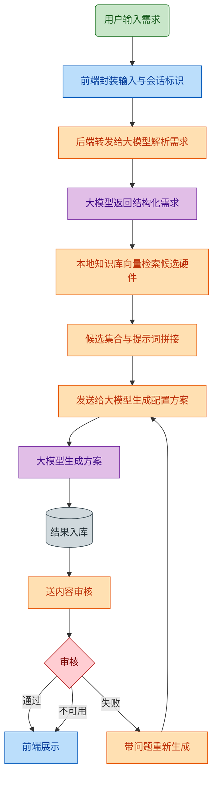

# 智能电脑配置推荐系统

> 基于大语言模型（LLM）与检索增强生成（RAG）的电脑配置推荐与硬件交流社区

[](https://www.python.org/)
[](https://www.djangoproject.com/)
[](https://vuejs.org/)
[](https://vitejs.dev/)
[](https://www.mysql.com/)
[](https://www.trychroma.com/)
[](LICENSE)

---

## 一、项目简介

用户输入预算与用途（如"8000 元，主要打游戏，偶尔剪视频"），系统解析需求后在**本地硬件知识库**中做向量检索，将检索到的候选硬件与预设提示词拼接后交给大模型，生成一份带总价约束的完整配置单；生成结果会经过一次**内容审核**，审核不通过则带着问题回炉重生成。配置单可一键转发到内置论坛，与其他用户的方案一起被点赞、评论、举报，并由管理员维护。

项目同时包含一套完整的**数据治理链路**：按 robots 规则爬取硬件数据 → 调用大模型清洗为结构化记录 → 向量化入 ChromaDB，使推荐结果始终基于最新的真实硬件与价格。

**规模**：后端 7,231 行 Python（49 个文件） · 前端 4,133 行 Vue/JS（9 个文件） · 56 个 API 端点 · 28 个数据库迁移。

---

## 二、核心功能

### 1. AI 智能配置推荐

- **多会话对话**：登录用户与游客（按 `session_key`）均可建立多个会话，历史消息持久化到 `ChatSession` / `ChatMessage`。
- **需求解析 → RAG 检索 → 生成 → 审核 → 失败重生成**：最多约 5 次模型调用的完整闭环，覆盖 14 类硬件（CPU / 显卡 / 主板 / 内存 / 硬盘 / 电源 / 机箱 / 散热器 / 笔记本 / 显示器 / 键鼠 / 耳机 / 音箱），字段定义见 [`参数.md`](参数.md)。
- **总价约束**：提示词层强制"预算优先"，生成后校验总价是否越界。
- **主备 API 回退**：`ApiConfig` 支持配置多条模型通道，逐条回退，首个成功即返回。
- **一键转论坛**：推荐结果可直接作为帖子发布。

### 2. 硬件交流论坛

- 发帖 / 评论，支持图片与附件上传；评论支持**楼中楼**父子嵌套回复。
- 点赞（切换语义）、举报、帖子**软删除**（`is_deleted` + `deleted_at`）。
- 三类站内通知：点赞通知、回复通知、系统通知，均带未读数与已读标记。
- 发帖与评论自动进入 **AI 内容审核**队列，命中敏感内容则标记待人工复核。

### 3. 管理后台

| 模块 | 能力 |
|---|---|
| 论坛管理 | 删帖恢复、评论恢复、用户封禁、举报处理、AI 封禁队列复核 |
| 模型配置 | 推荐链路与审核链路**两套独立** API 配置（增删改 + 在线连通性测试） |
| 提示词管理 | `PromptConfig` 在线编辑推荐提示词与每类检索条数（RAG top-k） |
| 硬件数据 | 查看 / 编辑 / SQL 导入 / AI 清洗 / 描述补全 / 向量化 / 过期向量清理 |
| 数据采集 | 爬虫任务启动 / 停止 / 进度轮询、爬虫日志查看与导出 |
| 方案库 | 每日从高赞帖子沉淀的推荐方案查看与删除、硬件权重调整记录 |

### 4. 数据采集与治理

- `scraper_service.py`：基于 `requests` + `BeautifulSoup` 抓取中关村在线（ZOL）列表页与详情页。
- **遵守 robots 规则**：跳过 `Disallow`、过滤含 `?` 的动态参数 URL、单线程、2–3 秒随机延迟（规则见 [`robots.md`](robots.md)）。
- 抓取的原始网页文本交给大模型清洗为 `name / model / price / desc` 结构化 JSON 后入库，并记录每次运行的 `ScraperRun`。

### 5. 定时任务

`APScheduler` 随 Django 启动（`RUN_MAIN` 守卫，避免 `runserver` 重载重复调度）：

- **每天 23:00**：扫描当天高赞帖子与评论，用模型判定是否为完整配置方案，沉淀进 `RecommendedScheme` 方案库。
- **每 1 小时**：批量处理 `ai_moderation_status='pending'` 的帖子与评论（每批 120 条），审核通道不可用时安全中断并保留待处理状态。

---

## 三、系统架构

### 推荐主链路



> 更多图（数据模型、前端组件结构等）见 [`docs/architecture/`](docs/architecture/)，源文件为 Mermaid `.mmd`，可直接在支持 Mermaid 的编辑器中打开修改。

### 分层说明

```
Vue 3 SPA  ──HTTP/Cookie Session──▶  Django 原生视图  ──▶  MySQL（业务数据）
     │                                      │
     └────────── 静态资源 /media ───────────┘
                                            ├──▶ ChromaDB（硬件向量库，本地持久化）
                                            ├──▶ BGE-small-zh-v1.5（本地 Embedding）
                                            └──▶ OpenAI 兼容 LLM API（推荐 / 审核 / 清洗）
```

---

## 四、技术栈

> 下表为**实际使用**的技术，与代码一一对应。

| 层次 | 选型 | 说明 |
|---|---|---|
| 前端框架 | **Vue 3**（SFC） | 未引入 vue-router，页面切换由 `App.vue` 内部状态驱动 |
| 前端构建 | **Vite 5** | 冷启动与 HMR |
| 状态管理 | `reactive` 响应式对象（`src/store.js`） | 未使用 Pinia/Vuex |
| HTTP | **axios** | 全局 `withCredentials = true`，依赖 Cookie 会话 |
| Markdown | **marked** | 渲染模型返回的 Markdown 配置单 |
| 后端框架 | **Django 4.2+** 原生视图 | 未使用 DRF，接口为手写 `JsonResponse`；开发环境实装 5.2 |
| 认证 | Django **Session + CSRF** | 前端跨域携带 Cookie，故 CORS 必须开 `CORS_ALLOW_CREDENTIALS` |
| 数据库 | **MySQL 8**（PyMySQL 驱动） | 连接参数全部走环境变量 |
| 定时任务 | **APScheduler** | `BackgroundScheduler`，注册于 `api/scheduler.py` |
| 大模型调用 | **LangChain `langchain_openai.ChatOpenAI`** | 指向任意 OpenAI 兼容端点 |
| 向量数据库 | **ChromaDB**（PersistentClient） | 本地目录 `vector_store/`，兜底 SQLite 相似度检索 |
| 文本向量化 | **sentence-transformers + BAAI/bge-small-zh-v1.5** | 中文小模型，本地推理，无需外网 |
| 爬虫 | **requests + BeautifulSoup4** | 遵守 robots 规则 |
| 中间件 | 自定义 `BannedUserMiddleware` | 封禁用户请求即时登出并返回 403 |

---

## 五、目录结构

```
pc-config-recommender/
├── backend_django/                  # Django 后端
│   ├── manage.py
│   ├── backend_django/
│   │   ├── settings.py              # 全局配置（全部读环境变量）
│   │   ├── urls.py                  # 根路由，挂载 /api/
│   │   └── wsgi.py
│   └── api/
│       ├── models.py                # 业务数据模型（363 行）
│       ├── views.py                 # 核心业务逻辑（4107 行）
│       ├── urls.py                  # 56 个接口路由
│       ├── llm_client.py            # LLM 调用封装与 base_url 规范化
│       ├── ai_moderation.py         # AI 内容审核
│       ├── scraper_service.py       # 爬虫 + AI 数据清洗（633 行）
│       ├── hardware_cleaner.py      # 硬件名称/参数清洗
│       ├── scheduler.py             # 定时任务注册
│       ├── task_daily_clean.py      # 每日高赞内容沉淀方案
│       ├── middleware.py            # 封禁用户拦截
│       ├── management/commands/     # 自定义管理命令
│       └── migrations/              # 28 个迁移
├── frontend/                        # Vue 3 前端
│   ├── package.json
│   ├── vite.config.js
│   └── src/
│       ├── main.js                  # 挂载 + axios 全局配置
│       ├── App.vue                  # 全局布局、导航、登录注册
│       ├── store.js                 # 全局响应式状态
│       └── components/
│           ├── RecommendForm.vue    # AI 对话推荐
│           ├── Forum.vue            # 论坛与帖子详情
│           ├── Manager.vue          # 管理后台
│           ├── MyPosts.vue          # 我的帖子
│           ├── MyMessages.vue       # 消息通知
│           └── Profile.vue          # 个人中心
├── docs/
│   └── architecture/                # 架构图（.mmd 源文件 + .png）
├── .env.example                     # 环境变量模板
├── requirements.txt
├── robots.md                        # 爬虫遵守的 robots 规则
├── 参数.md                           # 14 类硬件的参数字段定义
└── 说明文档.md                       # 逐文件、逐代码块的详细说明（403 行）
```

---

## 六、快速开始

### 环境要求

- Python 3.11
- Node.js 18+
- MySQL 8.0（需自行创建数据库，如 `project_db`，字符集 `utf8mb4`）
- 可选：Conda（用于隔离 Python 环境）

### 1. 后端

```powershell
git clone https://github.com/dingkunhe/pc-config-recommender.git
cd pc-config-recommender

conda create -y -n pc-config-env python=3.11
conda activate pc-config-env
pip install -r requirements.txt
```

创建配置文件并填入你的真实值（`.env` 已被 `.gitignore` 排除，不会提交）：

```powershell
Copy-Item .env.example .env
notepad .env
```

至少需要填 `MYSQL_PASSWORD` 和一个随机 `DJANGO_SECRET_KEY`：

```powershell
python -c "from django.core.management.utils import get_random_secret_key as k; print(k())"
```

建库、迁移、启动：

```powershell
mysql -u root -p -e "CREATE DATABASE project_db CHARACTER SET utf8mb4 COLLATE utf8mb4_unicode_ci;"
python backend_django/manage.py migrate
python backend_django/manage.py runserver 0.0.0.0:8000
```

创建管理员账号：`python backend_django/manage.py createsuperuser`

### 2. 前端

```powershell
cd frontend
npm install
npm run dev
```

默认地址 `http://localhost:5173`，需后端先启动（CORS 已放行 5173）。
**注意**：`RecommendForm.vue` 与 `Manager.vue` 中部分请求硬编码了 `http://localhost:8000`，换端口需同步修改。

### 3. 准备向量库（首次运行必需）

仓库**不包含**模型权重（单文件 91 MB）和向量库（41 MB），需自行生成：

**方式 A — 让代码自动下载**（默认走 `HF_ENDPOINT` 镜像）：

```powershell
python -c "from sentence_transformers import SentenceTransformer; SentenceTransformer('BAAI/bge-small-zh-v1.5')"
```

**方式 B — 手动放置**：将模型文件放到 `downloaded_models/bge-small-zh-v1.5/`，或用 `BGE_SMALL_ZH_MODEL_DIR` 指向任意位置。

随后登录管理后台 →「推荐系统」→「硬件数据」→ 先导入硬件数据，再点「向量化」构建 ChromaDB 索引。

---

## 七、大模型接入配置

系统不绑定任何厂商，`llm_client.py` 会把任意 `base_url` 规范化为 `.../chat/completions`，因此任何 **OpenAI 兼容端点**都能接入。两个入口：

1. **管理后台在线配置**（推荐）：登录管理员 →「推荐系统」→「API 配置」/「审核系统」，填写 `base_url`、`model_name`、`api_key`，点「测试」验证连通性后启用。
2. **直接写数据库**：`ApiConfig`（推荐链路）与 `AuditApiConfig`（审核链路）两张表。

常见 `base_url`：

| 服务 | base_url | 说明 |
|---|---|---|
| 硅基流动 | `https://api.siliconflow.cn/v1` | 项目默认验证对象 |
| DeepSeek | `https://api.deepseek.com/v1` | |
| Ollama（本地） | `http://localhost:11434/v1` | `api_key` 填任意占位符如 `ollama` |

> 走 Ollama 本地部署时，RAG 嵌入层（BGE + ChromaDB）本就完全本地，可做到推理全离线，无需任何外网。审核链路也可复用同一本地模型。

---

## 八、主要接口

统一前缀 `/api/`。认证方式为 Cookie Session，除登录注册外均需携带凭据。

| 分组 | 端点 |
|---|---|
| 基础 | `GET health/` |
| 推荐 | `POST recommend/` · `POST recommend/format_table/` · `GET|POST|DELETE chat/sessions/` · `GET chat/sessions/<id>/` |
| 用户 | `POST register/` · `POST login/` · `POST logout/` · `GET|POST profile/` · `POST activate-admin/` |
| 论坛 | `GET|POST posts/` · `GET|DELETE posts/<id>/` · `GET|POST posts/<id>/comments/` · `DELETE posts/<id>/comments/<cid>/` · `POST posts/<id>/like/` · `POST comments/<id>/like/` · `POST report/` |
| 通知 | `GET messages/unread-counts/` · `GET messages/likes/` · `GET messages/replies/` · `GET messages/system/` + 各自 `mark-read/` |
| 管理 · 论坛 | `GET admin/users/` · `POST admin/users/<id>/ban/` · `GET admin/posts/deleted/` · `POST admin/posts/<id>/restore/` · `GET|POST admin/reports/` · `POST admin/reports/<id>/handle/` |
| 管理 · 模型 | `admin/api_configs/` · `admin/audit_api_configs/` · `admin/prompt_configs/` |
| 管理 · 数据 | `POST admin/data_update/start|stop/` · `GET admin/data_update/status/` · `GET admin/scraper-logs/` · `GET admin/scraper-logs/export/` |
| 管理 · 硬件 | `admin/hardware/` · `admin/hardware/update/` · `import_sql/` · `cleanup/` · `transform/` · `complete_descriptions/` · `vectorize/` · `vector_cleanup_old/` |
| 管理 · 方案 | `admin/schemes/` · `admin/weight-adjustments/` · `POST admin/trigger_daily_clean/` |

---

## 九、安全说明

已做的处理：

- **凭据全部外置**：数据库密码、`SECRET_KEY`、管理员口令、激活码一律从环境变量 / `.env` 读取，仓库内不保存任何真实凭据；`.env` 与 `*.key`、`*.pem` 均在 `.gitignore` 中。
- **管理员激活入口默认关闭**：`ADMIN_ACTIVATE_CODE` 留空时 `activate-admin/` 接口不可用，避免固定口令提权。
- **爬虫合规**：遵守目标站点 robots 规则并限频。

已知的开发期默认值（部署前需收紧，见「后续改进」）：

- `DJANGO_DEBUG` 默认 `1`，`DJANGO_ALLOWED_HOSTS` 默认 `*`，`CORS_ALLOW_ALL_ORIGINS = True`、`CORS_ALLOW_CREDENTIALS = True`。
- `ADMIN_KEY` 的兜底默认值为 `changeme`。

---

## 十、已知限制与后续改进

这是一份毕业设计，以下问题已明确识别，是后续迭代的方向：

| 类别 | 问题 | 改进方向 |
|---|---|---|
| 正确性 | `views.py` 中 `format_table_view`、`admin_schemes_view`、`admin_delete_scheme_view`、`trigger_daily_clean_view` 各存在重复定义，靠后定义覆盖靠前 | 去重并补单元测试 |
| 死代码 | `views.py` 中 `from src.scraper import scrape_urls`，但项目无 `src/` 目录，`scrape_view` 恒返回不可用 | 删除该分支 |
| 性能 | `posts_view` / `post_detail_view` 存在 N+1 查询，无 `select_related` / `prefetch_related`，且未分页 | 查询优化 + 分页 |
| 性能 | 推荐接口为同步串行长链路（最多 5 次模型调用），无流式输出 | 改流式（SSE）响应 |
| 性能 | `admin_hardware_view` 在 Python 层做品牌/价格/关键词过滤，全表遍历 | 下推到 ORM 查询 |
| 安全 | `ApiConfig.api_key` 明文存储且明文回传前端 | 加密存储 + 回传脱敏 |
| 安全 | 前端 `v-html` 直接渲染 `marked.parse()` 结果，未做 HTML 消毒 | 引入 DOMPurify |
| 安全 | 注册接口无格式校验、密码强度校验与防刷 | 补充校验与限流 |
| 健壮性 | LLM 重试判断依赖错误信息字符串匹配（`'429' in err`） | 改用状态码与异常类型 |
| 健壮性 | BGE 模型加载无线程锁，并发首请求可能重复加载 | 加锁 + 懒加载单例 |
| 数据模型 | `PriceHistory.date` 用 `CharField` 存日期而非 `DateField` | 迁移为 `DateField` |
| 部署 | 定时任务仅在 `RUN_MAIN == 'true'` 时启动，仅适配 `runserver` | 拆分为独立 worker 或 Celery |
| 工程 | 前端 API 地址硬编码 `http://localhost:8000` | 改用 Vite 环境变量 |

---

## 十一、文档

- [`说明文档.md`](说明文档.md) — 逐文件、逐代码块的实现说明（含每个接口与模型的职责）
- [`参数.md`](参数.md) — 14 类硬件的参数字段定义
- [`robots.md`](robots.md) — 爬虫遵守的 robots 规则
- [`docs/architecture/`](docs/architecture/) — 架构图与数据模型图（Mermaid 源文件）

---

## 十二、许可

本项目采用 MIT License，详见 [LICENSE](LICENSE)。

> 本项目为个人毕业设计作品，仅供学习与交流使用。爬取数据版权归原站点所有，请勿用于商业用途。
